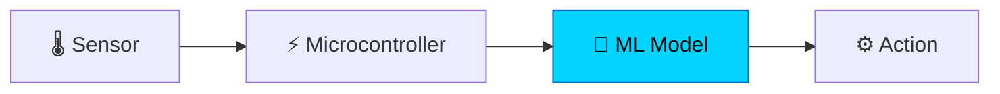

<div align="center">

<a href="https://github.com/YuHimsanda">
  
</a>

[](https://www.linkedin.com/in/yuhimsanda/)
[](mailto:yuhimsanda@gmail.com)

</div>

```js
const yuhas = {
  studying: "BSc (Hons) Computer Engineering @ KDU",
  from:     "Galle, Sri Lanka 🇱🇰",
  obsessedWith: ["AI/ML", "Embedded systems", "Robotics"],
  goal:     "Run ML models directly on chips",
  status:   "Learning by building 🛠️",
};
```

## 💡 The idea I'm chasing

Most AI lives in the cloud. I want to move it **into the hardware**, so a tiny chip can sense, think and act on its own.



I started with the basics: a thermistor, a comparator and a fan. Next step is replacing the fixed threshold with a model that learns.

## 🧰 Click to explore

<details>
<summary><b>🚀 Projects</b></summary>
<br/>

- **Sports Management System**: web app with an HTML/CSS/JS frontend and a PHP + MySQL backend
- **Temperature-controlled cooling fan**: NTC thermistor + LM741 comparator switching a 12V fan
- **Next up**: my first TinyML experiment 👀

</details>

<details>
<summary><b>📚 What I'm learning</b></summary>
<br/>

- Data structures & algorithms
- Database design (EER modelling)
- How Java runs under the hood (bytecode & JVM)
- Machine learning fundamentals, then Edge AI / TinyML

</details>

<details>
<summary><b>🛠️ Tools I use</b></summary>
<br/>

`Java` · `HTML` · `CSS` · `JavaScript` · `PHP` · `MySQL` · `React` · `Tailwind` · `Git`

</details>

<details>
<summary><b>🗺️ Roadmap</b></summary>
<br/>

- [x] Programming & electronics fundamentals
- [ ] ML fundamentals
- [ ] TinyML on a microcontroller
- [ ] FPGA / hardware acceleration basics
- [ ] Deploy a model on a real chip 🎉

</details>

---

<div align="center">

*If you work in AI/ML, embedded systems or chip design, I'd love to connect and learn from you.*

</div>
